# Fairings by Purrline Rocketworks  

Payload fairings for [Kitten Space Agency](https://ahwoo.com/app/100000/kitten-space-agency), from the fictional rocket maker Purrline Rocketworks: fairing halves of 2 m and 3 m in three lengths, white or black carbon, with bases for 2 m and 3 m stacks and hammerhead bases that put a wider fairing on a narrower stage.

Validated against KSA build version 2026.11.10.5801.

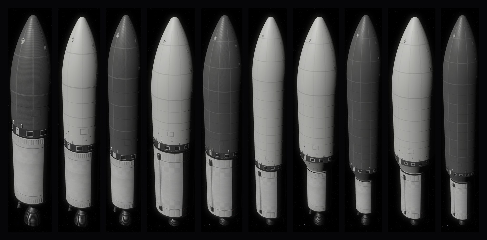

## Parts

| Picture | Part | What it is |
| --- | --- | --- |
| 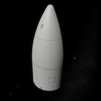 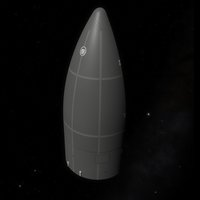 | **Fairing Half 2 m Short** | 4.55 m long; place two; white or carbon |
| 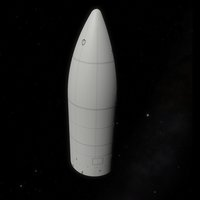 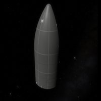 | **Fairing Half 2 m Medium** | 6.10 m long; the fairing of Prisma; white or carbon |
| 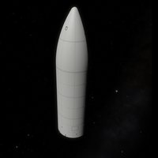 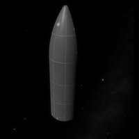 | **Fairing Half 2 m Long** | 7.65 m long; white or carbon |
| 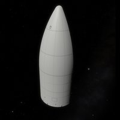 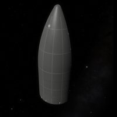 | **Fairing Half 3 m Short** | 7.60 m long; white or carbon |
| 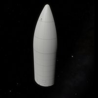 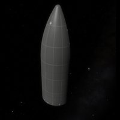 | **Fairing Half 3 m Medium** | 9.15 m long; white or carbon |
| 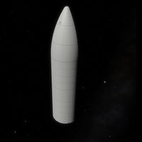 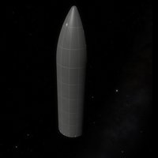 | **Fairing Half 3 m Long** | 12.25 m long; white or carbon |
| 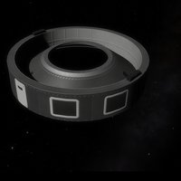 | **Fairing Base 2 m** | Base ring for a 2 m stack, with a 1 m payload adapter |
| 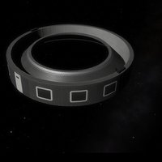 | **Fairing Base 3 m** | Base ring for a 3 m stack, with a 2 m payload adapter |
| 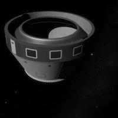 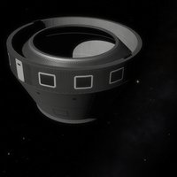 | **Fairing Base 2 m to 3 m** | Hammerhead base: a 3 m fairing on a 2 m stage, 2 m payload adapter; white or carbon |
| 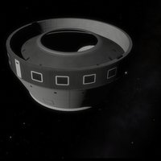 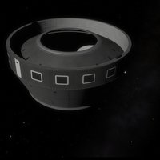 | **Fairing Base 3 m to 4 m** | Hammerhead base: a 4 m fairing on a 3 m stage, 2 m payload adapter; white or carbon |

All parts on one sheet: [images/parts/all-parts.jpg](images/parts/all-parts.jpg)

Every half and the two hammerhead bases come in two looks: white paint and black carbon. Press V on a placed part to change the look. The Fairing Base 2 m and the Fairing Base 3 m have one look, a black ring that fits both. Inside each half is a quilted acoustic blanket that you see when the halves fall away.

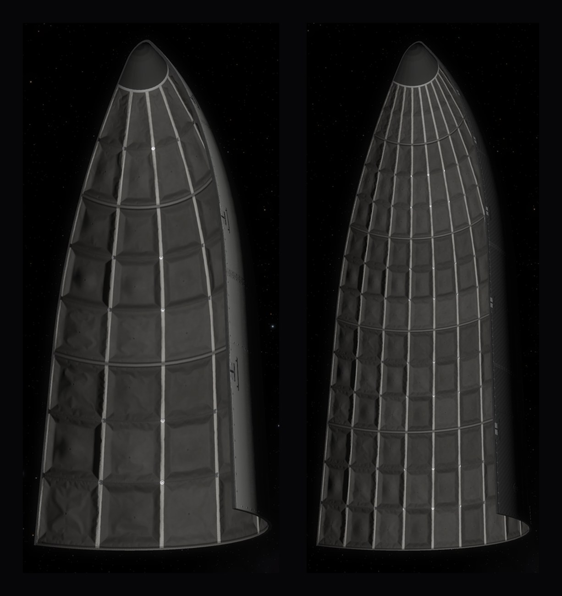

## How to build a fairing

1. Put a base on the top of your stage: the Fairing Base 2 m on a 2 m stage, the Fairing Base 3 m on a 3 m stage, or a hammerhead base when the fairing is wider than the stage.
2. Put the payload on the inner connector at the top of the base.
3. Put two halves of the same size on the two side connectors of the base.
4. Put the halves into one stage. When that stage fires, each half moves straight out and away.

Payload space inside the fairing (the widest payload that fits, with a small margin): 2 m fairing 1.62 m, 3 m fairing 2.66 m, 4 m fairing 3.55 m.

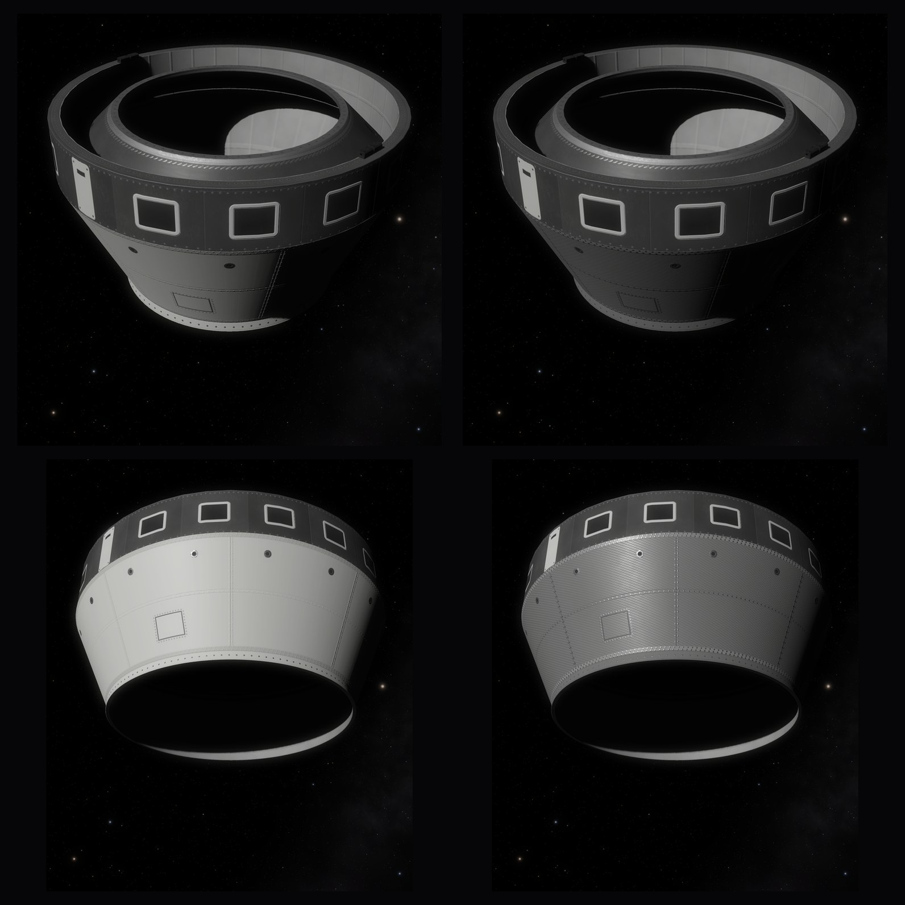

## Other sizes with the scale tool

The scale tool of the editor (key 4) scales a part in steps of 0.25 m of its largest diameter, from half to double size. Scale the base and both halves alike.

- 1 m fairing: the 2 m base and halves at 0.5.
- 4 m fairing: the Fairing Base 3 m to 4 m with two 3 m halves at 1.33 (4 m), or two 2 m halves at 2.0.
- 3 m fairing from 2 m halves: two 2 m halves at 1.5 on the Fairing Base 3 m or the Fairing Base 2 m to 3 m.

A scaled half is heavier or lighter by the cube of the scale, and its split gets stronger by the square of the scale, so a large half leaves more slowly. The split is sized so that the halves clear the payload at double size, also while the stage accelerates at 2 g.

## Prisma

The 2 m medium half and the 2 m base were the fairing of [Prisma by Purrline Rocketworks](https://github.com/Maximilian-Nesslauer/KSA-PurrlinePrisma) 1.0.0. They keep their part Ids, so vehicles that you saved with Prisma load with their fairing. Prisma 1.1.0 and later contain the same 2 m fairing, so you can install Prisma and this mod together, in any mod order, and the game loads the fairing one time.

**Update Prisma to 1.1.0 or later before you enable this mod.** Prisma 1.0.0 contains the same fairing parts in an older form, and with both enabled the fairing does not load. Borea does not let Prisma 1.0.0 and this mod into one instance.

## Install

No other mod needed.

- Borea: install Fairings from the content list.
- By hand: copy `PurrlineFairings` from the release zip into `Documents/My Games/Kitten Space Agency/mods/` and enable it.

To remove the mod, delete its folder. Vehicles with its parts do not load without it.

Works well with [Prisma by Purrline Rocketworks](https://github.com/Maximilian-Nesslauer/KSA-PurrlinePrisma) (a small launcher) and [Facet](https://github.com/Maximilian-Nesslauer/KSA-PurrlineFacet) (satellites for the fairing).

## Licence

Code and game data: MIT ([LICENSE](LICENSE)). Meshes, textures, logo and pictures: CC BY 4.0 ([LICENSE-ART](LICENSE-ART)). Credits: [NOTICE.md](NOTICE.md).

## Links

[Forum thread](https://forums.ahwoo.com/threads/fairings-by-purrline-rocketworks.ID/) | [Issues](https://github.com/Maximilian-Nesslauer/KSA-PurrlineFairings/issues)
